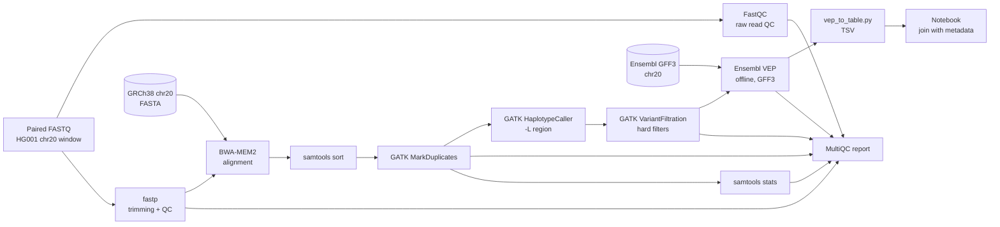
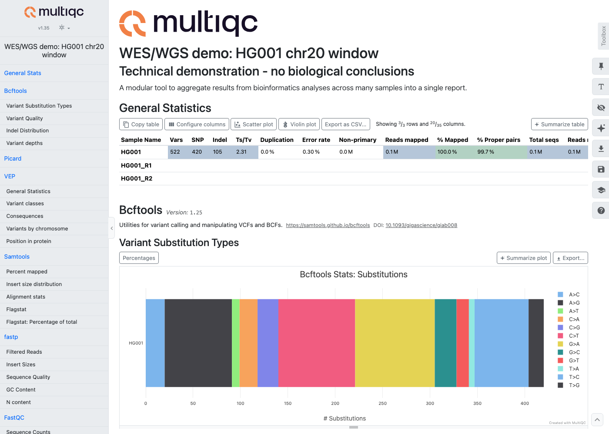

# WES/WGS Pipeline Demo: FASTQ to annotated variants

[](https://github.com/alma-pc/WES_WGS_Pipeline_demo/actions/workflows/ci.yml)


A small, reproducible **germline short-variant workflow** built with Snakemake. It runs from raw
paired-end FASTQ files to a VEP-annotated variant table and integrates that table with sample
metadata in a Python notebook. It uses public data only and runs on a laptop in under 30 minutes.

> [!IMPORTANT]
> **This is a technical demonstration.** It processes a 500 kb window of chromosome 20 from a
> single public reference sample. It is not intended to produce, and must not be used for,
> biological, clinical or association conclusions. Filters and parameters are illustrative,
> not tuned or validated.

## Why this exists

Real genomics projects rarely use data from a single source. Exomes and genomes,
samples sequenced at different times, and public cohorts on different reference builds
all have to end up in one table. Most of what goes wrong there is not biology but
bookkeeping: mismatched builds, inconsistent formats, ambiguous sample IDs.
This repository shows how I keep that path reproducible, from raw FASTQ to an
integrated, traceable variant table.

## Objective

Show, end to end, the engineering side of a WES/WGS analysis:

- reproducible environments (conda and Docker) and a single configuration file
- a modular Snakemake workflow with logging and QC aggregation
- standard tools: FastQC, fastp, MultiQC, BWA-MEM2, GATK, Ensembl VEP
- turning a VCF into a tidy, typed table and joining it with harmonized metadata

## Workflow



| Step | Tool | Main output |
|---|---|---|
| Raw read QC | FastQC | `results/qc/fastqc/` |
| Trimming and QC | fastp | `results/trimmed/`, `results/qc/fastp/` |
| Alignment | BWA-MEM2 + samtools | `results/align/*.sorted.bam` (temporary) |
| Duplicate marking | GATK MarkDuplicates | `results/align/*.dedup.bam` |
| Variant calling | GATK HaplotypeCaller | `results/variants/*.raw.vcf.gz` |
| Hard filtering | GATK VariantFiltration | `results/variants/*.filtered.vcf.gz` |
| Annotation | Ensembl VEP (GFF mode) | `results/annotation/*.vep.vcf.gz` |
| Tabulation | `scripts/vep_to_table.py` | `results/tables/*.variants.tsv` |
| QC summary | MultiQC | `results/qc/multiqc/multiqc_report.html` |
| Integration | Jupyter + pandas | `results/integrated/variants_with_metadata.tsv` |

### QC report

All QC outputs (FastQC, fastp, MarkDuplicates, samtools, bcftools, VEP) are collected into
a single MultiQC report. The screenshot below shows the top of the report produced by the
demo run:



`config/multiqc_config.yaml` hides local file paths and run timestamps, so the report can be
shared without exposing details about the machine.

## Requirements

- macOS or Linux (x86_64). On Apple Silicon, use Docker with `--platform linux/amd64` or a Rosetta conda install.
- About 8 GB RAM, 4 CPU cores and **at least 7 GB of free disk space**.
- An internet connection for the one-time data download (~30 MB on disk) and the conda packages.
- **One of:**
  - [Miniforge / Mambaforge](https://github.com/conda-forge/miniforge) (recommended, tested) or conda ≥ 23
  - [Docker](https://docs.docker.com/get-docker/) (untested, see below)

Measured on an Intel MacBook (x86_64, 8 GB RAM, 4 cores used) with a home internet connection:

| Step | Time |
|---|---|
| Create the conda environment (`mamba`) | ~4.5 min |
| `scripts/download_data.sh` | ~3 min |
| `snakemake --cores 4 --use-conda`, first run (includes building the VEP env) | ~6.5 min |
| Notebook | < 15 s |
| **Total** | **~15 min** |

Disk use is about 6 GB for the two conda environments (main env + VEP env in `.snakemake/conda`) and about 0.5 GB for data, reference index and results.

## Quick start (conda)

```bash
# 1. Clone
git clone https://github.com/alma-pc/WES_WGS_Pipeline_demo.git
cd WES_WGS_Pipeline_demo

# 2. Create and activate the environment
conda env create -f environment.yml        # or: mamba env create -f environment.yml
conda activate wes-demo

# 3. Download the public test data (reads, chr20 reference, GFF3)
bash scripts/download_data.sh

# 4. Preview the jobs, then run the pipeline
#    --use-conda lets Snakemake build the small VEP environment (first run only)
snakemake -n --cores 4 --use-conda
snakemake --cores 4 --use-conda --printshellcmds

# 5. Open the QC report and run the integration notebook
open results/qc/multiqc/multiqc_report.html     # xdg-open on Linux
jupyter lab notebooks/01_integrate_variants_metadata.ipynb
```

The same steps are available through `make`: run `make help` to list them.

## Quick start (Docker, untested)

> [!WARNING]
> **The Docker setup has not been tested yet.** The `Dockerfile` installs the same pinned
> `environment.yml` that was validated with conda, but the image has not been built or run.
> The conda route above is the tested way to run this demo.

```bash
docker build -t wes-wgs-demo .
docker run --rm -v "$PWD":/work wes-wgs-demo bash scripts/download_data.sh
docker run --rm -v "$PWD":/work wes-wgs-demo snakemake --cores 4 --use-conda
# Notebook
docker run --rm -p 8888:8888 -v "$PWD":/work wes-wgs-demo \
    jupyter lab --ip=0.0.0.0 --no-browser notebooks/
```

## Configuration

All paths and parameters are in [`config/config.yaml`](config/config.yaml). Samples are listed in
[`config/samples.tsv`](config/samples.tsv).

| Key | Purpose |
|---|---|
| `threads` | Threads for fastp, BWA-MEM2 and samtools |
| `region` | GRCh38 window used for variant calling (keep in sync with `REGION` in the download script) |
| `fastp.extra` | Trimming options |
| `gatk.java_opts` | JVM memory for GATK |
| `gatk.hard_filters` | List of `name` / `expression` pairs for VariantFiltration |
| `vep.extra` | VEP options (symbols, HGVS, `--flag_pick_allele`, …) |

To change the window, edit `region` in the config **and** run the download with the matching
source region, for example `REGION=chr20:40000000-40500000 bash scripts/download_data.sh`.
Delete `data/raw/` first so the reads are fetched again.

## Repository structure

```
WES_WGS_Pipeline_demo/
├── README.md
├── LICENSE                      # MIT
├── environment.yml              # main conda environment (all tools except VEP)
├── Dockerfile                   # same environment in a container (untested)
├── Makefile                     # convenience targets (make help)
├── config/
│   ├── config.yaml              # paths and parameters
│   ├── multiqc_config.yaml      # report title, hides local paths
│   └── samples.tsv              # sample sheet
├── workflow/
│   ├── Snakefile                # entry point, target rule `all`
│   ├── envs/vep.yml             # isolated Ensembl VEP environment (--use-conda)
│   └── rules/                   # one .smk file per stage
│       ├── reference.smk        # faidx, .dict, BWA-MEM2 index, GFF3 for VEP
│       ├── qc.smk               # FastQC, fastp, MultiQC
│       ├── align.smk            # BWA-MEM2, sort, index, samtools stats
│       ├── dedup.smk            # MarkDuplicates
│       ├── call.smk             # HaplotypeCaller, VariantFiltration, bcftools stats
│       ├── annotate.smk         # Ensembl VEP
│       └── table.smk            # VCF -> TSV
├── scripts/
│   ├── download_data.sh         # fetches and documents the public data
│   └── vep_to_table.py          # flattens VEP CSQ into a tidy TSV
├── notebooks/
│   └── 01_integrate_variants_metadata.ipynb
├── metadata/
│   └── example_sample_metadata.tsv   # synthetic, intentionally messy
├── docs/
│   ├── DATA_SOURCES.md          # origin, licences and citations
│   └── img/multiqc_report.png   # screenshot used in this README
├── tests/data/mini.vep.vcf      # tiny fixture used by CI
└── .github/workflows/ci.yml     # unit test + Snakemake dry-run

# Created at runtime (git-ignored)
data/raw/  resources/  results/  logs/  .snakemake/
```

## Output table

`results/tables/<sample>.variants.tsv` has one row per *(variant, ALT allele, VEP consequence)*:

| Column(s) | Description |
|---|---|
| `sample_id, chrom, pos, ref, alt` | Variant identity (Ensembl contig naming) |
| `qual, filter` | GATK QUAL and filter status (`PASS` or a hard-filter name) |
| `gt, dp, gq, ad_ref, ad_alt` | Sample genotype, depth, genotype quality and allele depths |
| `consequence, impact` | VEP Sequence Ontology term(s) and impact class |
| `symbol, gene, feature_type, feature, biotype` | Gene and transcript |
| `exon, intron, hgvsc, hgvsp` | Position within the transcript and HGVS notation |
| `variant_class, pick` | SNV/indel class; `pick == 1` marks the one consequence VEP selects per ALT allele (`--flag_pick_allele`) |

## Data sources

| Data | Source | Licence |
|---|---|---|
| Illumina reads of HG001 / NA12878, `chr20:33.0–33.5 Mb`, ~30× | [Genome in a Bottle (NIST)](https://www.nist.gov/programs-projects/genome-bottle) | Public domain (U.S. Government work) |
| GRCh38 chromosome 20 FASTA | [Ensembl release 116](https://ftp.ensembl.org/pub/release-116/) | Unrestricted |
| GRCh38 chromosome 20 GFF3 | [Ensembl release 116](https://ftp.ensembl.org/pub/release-116/) | Unrestricted |
| Sample metadata | Synthetic, created for this repo | MIT (this repo) |

Full details, the exact subsetting procedure and citations are in [docs/DATA_SOURCES.md](docs/DATA_SOURCES.md).
`scripts/download_data.sh` also writes checksums to `data/MANIFEST.txt`.

## Design notes

- **Chromosome 20 only:** real GRCh38 coordinates, with a reference index small enough for a laptop.
- **VEP in GFF mode:** annotation comes from the Ensembl GFF3 and FASTA, so no 20+ GB cache is needed.
- **Hard filters instead of VQSR:** VQSR and CNN filtering need many samples or a larger genome.
  Simple filters are enough to show the step.
- **One main conda environment plus an isolated one for VEP:** `environment.yml` holds every tool
  you install by hand. Ensembl VEP gets its own `workflow/envs/vep.yml`, because bioconda's
  `ensembl-vep` depends on `perl-bio-samtools`, which pins `samtools 0.1.x` and would downgrade
  the modern samtools used by the rest of the pipeline. Snakemake builds that environment
  automatically with `--use-conda`.

## Disclaimer

This repository is a portfolio demo of workflow engineering. It processes a tiny subset of one
publicly available reference genome and draws **no** biological, clinical or population-level
conclusions. The metadata are synthetic.

## License

Code is released under the [MIT License](LICENSE). Input data keep their original licences (see above).
